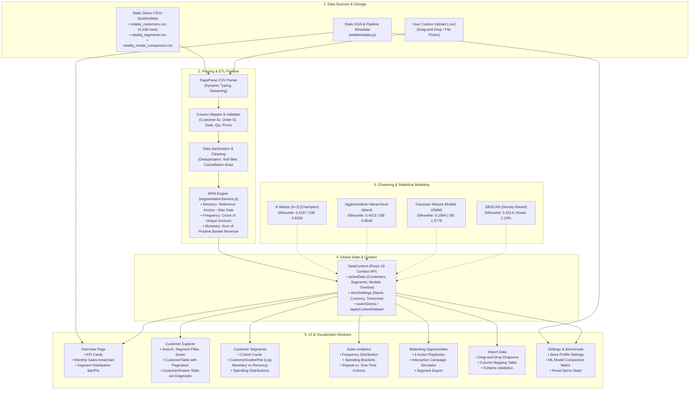
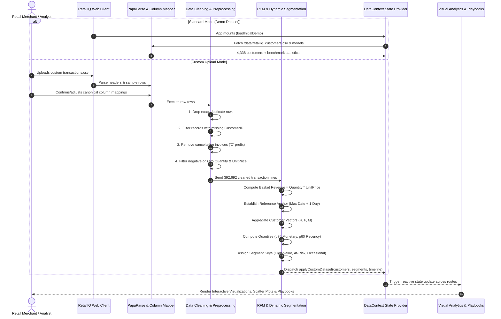
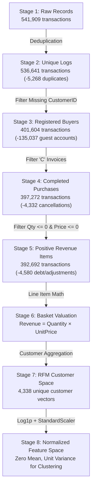

# RetailIQ — ML-Powered Customer Segmentation & Marketing Intelligence Platform

> **AI-driven retail customer intelligence platform** transforming raw e-commerce transaction logs into predictive customer segments, statistical behavioral insights, and targeted marketing playbooks.

[](https://react.dev/)
[](https://vitejs.dev/)
[](https://tailwindcss.com/)
[](https://recharts.org/)
[](https://creativecommons.org/licenses/by/4.0/)

---

## Table of Contents

1. [Executive Overview](#1-executive-overview)
2. [System Architecture](#2-system-architecture)
3. [End-to-End Data & Processing Flow](#3-end-to-end-data--processing-flow)
4. [How Things Are Working (Deep Dive)](#4-how-things-are-working-deep-dive)
   - [4.1 The Underlying Dataset & Attribution](#41-the-underlying-dataset--attribution)
   - [4.2 8-Stage Data Cleaning & Preprocessing Funnel](#42-8-stage-data-cleaning--preprocessing-funnel)
   - [4.3 Mathematical Formulation of the RFM Feature Space](#43-mathematical-formulation-of-the-rfm-feature-space)
   - [4.4 Unsupervised Clustering Algorithm Benchmark](#44-unsupervised-clustering-algorithm-benchmark)
   - [4.5 Identified Behavioral Segments & Economics](#45-identified-behavioral-segments--economics)
   - [4.6 Real-Time In-Browser CSV Processing Engine](#46-real-time-in-browser-csv-processing-engine)
   - [4.7 Marketing Opportunity Engine & Campaign Simulator](#47-marketing-opportunity-engine--campaign-simulator)
5. [Application Modules & Navigation](#5-application-modules--navigation)
6. [Repository & Codebase Structure](#6-repository--codebase-structure)
7. [Installation & Setup](#7-installation--setup)
8. [Technical Viva & Academic Defense Cheatsheet](#8-technical-viva--academic-defense-cheatsheet)
9. [Limitations & Future Roadmap](#9-limitations--future-roadmap)

---

## 1. Executive Overview

Retail organizations operating high-volume transactional channels encounter a fundamental challenge: **heterogeneous customer purchasing behaviors are frequently treated with homogeneous, broadcast marketing campaigns**. This results in wasted ad spend, margin erosion through unneeded discounts to already-loyal buyers, and customer churn from unrecognized account dormancy.

**RetailIQ** solves this by establishing a complete unsupervised machine learning and data analytics pipeline that:
1. **Cleans and transforms** raw transaction records (541,909 logs from the UCI Online Retail repository).
2. **Aggregates customer records** into normalized **Recency, Frequency, and Monetary (RFM)** vectors.
3. **Applies algorithmic clustering** (benchmarking K-Means, Agglomerative Hierarchical, Gaussian Mixture Models, and DBSCAN) to isolate high-affinity behavioral clusters.
4. **Translates mathematical clusters into actionable commercial segments**: High-Value VIPs, At-Risk Inactives, and Occasional Growth accounts.
5. **Simulates ROI-driven marketing campaigns** with dynamic discount, reach, and budget modeling.
6. **Supports custom data ingestion** via an in-browser streaming CSV parser and automated RFM pipeline.

---

## 2. System Architecture

The following diagram illustrates the complete modular architecture of RetailIQ, from static benchmark assets and client-side processing engines up to reactive UI components and presentation layers:



---

## 3. End-to-End Data & Processing Flow

The lifecycle of transactional records—from raw tabular rows to executive decision metrics—progresses through the following sequential flow:



---

## 4. How Things Are Working (Deep Dive)

### 4.1 The Underlying Dataset & Attribution

The default baseline dataset is the celebrated **Online Retail Dataset** from the **UCI Machine Learning Repository** (licensed under CC BY 4.0):
* **Domain:** Non-store online retail registered in the United Kingdom, selling unique gift-ware and wholesale novelties.
* **Observation Period:** 1 December 2010 to 9 December 2011 (1 year, 8 days).
* **Initial Records:** 541,909 raw invoice line items across 38 countries.
* **Currency:** British Pound Sterling (GBP, £).
* **Citation:** *Daqing Chen, Sai Liang Sain, and Kun Guo, "Data mining for the online retail industry: A case study of RFM model-based customer segmentation using data mining", Journal of Database Marketing & Customer Strategy Management, Vol. 19, No. 3, pp. 197-208, 2012.*

---

### 4.2 8-Stage Data Cleaning & Preprocessing Funnel

Raw e-commerce transaction logs contain noise, refunds, guest checkouts, and accounting adjustments. RetailIQ relies on an 8-stage cleaning pipeline:



#### Funnel Audit Matrix:

| Stage # | Pipeline Operation | Input Count | Output Count | Excluded Count | Rationale & Impact |
|:---:|:---|:---:|:---:|:---:|:---|
| **1** | Raw Dataset Import | 541,909 | 541,909 | 0 | Ingestion of raw transactional records across 38 countries. |
| **2** | Duplicate Elimination | 541,909 | 536,641 | 5,268 | Discards network retries, browser double-submits, and logging errors. |
| **3** | Unregistered Guest Removal | 536,641 | 401,604 | 135,037 | 24.93% of records lacked a `CustomerID`. Longitudinal RFM tracking requires identifiable customer accounts. |
| **4** | Cancellation / Return Drop | 401,604 | 397,272 | 4,332 | Excludes credit notes and returns (invoices prefixed with `C`) to prevent negative revenue distortion. |
| **5** | Non-Positive Value Filter | 397,272 | 392,692 | 4,580 | Drops damaged inventory write-offs, bad debt corrections, and £0 promotional samples. |
| **6** | Basket Total Computation | 392,692 | 392,692 | 0 | Calculates gross item spend: $\text{Spend} = \text{Quantity} \times \text{UnitPrice}$. |
| **7** | Customer RFM Aggregation | 392,692 | 4,338 | 0 | Compresses 392k transaction rows into 4,338 unique customer behavior vectors. |
| **8** | Feature Normalization | 4,338 | 4,338 | 0 | Corrects heavy right-skew with $\log(1 + x)$ followed by z-score standardization ($z = (x - \mu)/\sigma$). |

---

### 4.3 Mathematical Formulation of the RFM Feature Space

For each customer $i \in \{1, \dots, N\}$, the transactional history is reduced to three behavioral coordinates:

1. **Recency ($R_i$):**
   The elapsed days between the customer's latest purchase timestamp and the dataset observation reference date ($T_{\text{ref}} = \text{2011-12-10}$):
   $$R_i = \left\lfloor \frac{T_{\text{ref}} - \max(t_{i,j})}{86400 \times 1000} \right\rfloor$$
   *Lower $R_i$ denotes an active, recent buyer.*

2. **Frequency ($F_i$):**
   The total number of distinct, non-cancelled invoice sessions initiated by customer $i$:
   $$F_i = \left| \{ \text{InvoiceNo}_{i,j} \} \right|$$
   *Higher $F_i$ indicates a loyal, repeat purchaser.*

3. **Monetary ($M_i$):**
   The cumulative gross expenditure across all positive transactions for customer $i$:
   $$M_i = \sum_{j} (\text{Quantity}_{i,j} \times \text{UnitPrice}_{i,j})$$
   *Reflects the cumulative financial yield of the customer relationship.*

#### Why Log Transformation & Standardization are Crucial:
Raw retail spend exhibits massive Pareto skewness (raw monetary skew exceeds $+458.2$; minimum spend is £3.75 while maximum commercial wholesaler spend reaches £280,206.02). 

If standard Euclidean distance is calculated directly on raw values:
$$d(p, q) = \sqrt{(R_p - R_q)^2 + (F_p - F_q)^2 + (M_p - M_q)^2}$$
The monetary dimension ($M$) completely dominates the metric, collapsing 98% of typical customers into an indistinguishable single point near the origin.

To solve this:
1. **Natural Log Shift:** $x_{\text{transformed}} = \ln(1 + x)$ is applied to compress multi-order-of-magnitude ranges.
2. **StandardScaler (Z-Score):** $z = \frac{x_{\text{transformed}} - \mu}{\sigma}$, forcing all three features to mean 0 and unit variance 1.

---

### 4.4 Unsupervised Clustering Algorithm Benchmark

Four clustering paradigms were empirically evaluated on the standardized 3D feature space:

| Model Paradigm | Algorithm | Clusters ($k$) | Noise (%) | Runtime (s) | Silhouette Score (↑) | Davies-Bouldin Index (↓) | Calinski-Harabasz Score (↑) | Evaluation Verdict |
|:---|:---|:---:|:---:|:---:|:---:|:---:|:---:|:---|
| **Centroid Partitioning** | **K-Means** | **3** | **0.0%** | **0.2303s** | **0.4157** | **0.8250** | **4,393.91** | **Champion Model** |
| **Hierarchical** | Agglomerative (Ward) | 3 | 0.0% | 1.6457s | 0.4013 | 0.8548 | 4,227.25 | Strong benchmark, but $7.1\times$ slower runtime |
| **Probabilistic** | Gaussian Mixture (GMM) | 3 | 0.0% | 0.2629s | 0.1904 | 1.5778 | 1,886.90 | Suboptimal: high component overlap in density |
| **Density-Based** | DBSCAN | 2 | 2.19% | 0.1413s | 0.3314 | 1.1153 | 2,493.77 | Isolated 95 outliers, but merged cohorts into 2 clusters |

#### Metric Definitions:
* **Silhouette Score:** Evaluates how similar an object is to its own cluster compared to neighboring clusters (range $[-1, 1]$). K-Means achieved the highest score ($0.4157$), demonstrating tight, isolated groupings.
* **Davies-Bouldin Index:** Measures average similarity between each cluster and its most similar counterpart (lower is better). K-Means achieved the lowest ratio ($0.8250$).
* **Calinski-Harabasz Index:** Variance ratio criterion measuring dispersion between-clusters versus within-clusters. K-Means peaked at $4,393.91$.

---

### 4.5 Identified Behavioral Segments & Economics

The champion 3-cluster partition yields intuitive, highly actionable business cohorts:

```
               [All Customers: 4,338 Accounts / £8.89M Revenue]
                                       |
        +------------------------------+------------------------------+
        |                                                             |
   Cluster 0: High-Value VIPs                                    Clusters 1 & 2
   (1,320 accounts / 30.4%)                               (3,018 accounts / 69.6%)
   [81.6% of Revenue: £7.25M]                                        |
                                              +----------------------+----------------------+
                                              |                                             |
                                  Cluster 2: Occasional                         Cluster 1: At-Risk
                                  (2,037 accounts / 47.0%)                      (981 accounts / 22.6%)
                                  [14.0% of Revenue: £1.25M]                    [4.4% of Revenue: £390k]
```

#### Detailed Cohort Profiles:

```
+-----------------------------------------------------------------------------------------------------+
| Cohort 0: High-Value VIP Customers                                                                   |
+-----------------------------------------------------------------------------------------------------+
| • Audience Share:   1,320 customers (30.4%)                                                         |
| • Revenue Share:    £7,249,492.37 (81.6% of total business revenue)                                  |
| • Median Recency:   17 days                                                                         |
| • Median Frequency: 7 orders (up to 209 orders)                                                     |
| • Median Spend:     £2,570.50 (up to £280,206.02)                                                   |
| • Key Takeaway:     High-velocity wholesale and recurring commercial buyers. Do NOT discount heavily;   |
|                     nurture with VIP tier benefits, priority fulfillment, and early catalog previews.|
+-----------------------------------------------------------------------------------------------------+

+-----------------------------------------------------------------------------------------------------+
| Cohort 1: At-Risk / Inactive Customers                                                               |
+-----------------------------------------------------------------------------------------------------+
| • Audience Share:   981 customers (22.6%)                                                           |
| • Revenue Share:    £389,626.80 (4.4% of total business revenue)                                    |
| • Median Recency:   253 days (~8.5 months of silence)                                               |
| • Median Frequency: 1 order                                                                         |
| • Median Spend:     £290.51                                                                         |
| • Key Takeaway:     One-time buyers with imminent probability of total churn. Deploy 2-stage         |
|                     automated win-back email sequence with time-bounded reactivation vouchers.         |
+-----------------------------------------------------------------------------------------------------+

+-----------------------------------------------------------------------------------------------------+
| Cohort 2: Occasional / Growing Customers                                                            |
+-----------------------------------------------------------------------------------------------------+
| • Audience Share:   2,037 customers (47.0% - largest segment)                                        |
| • Revenue Share:    £1,248,089.72 (14.0% of total revenue)                                          |
| • Median Recency:   45 days                                                                         |
| • Median Frequency: 2 orders                                                                         |
| • Median Spend:     £508.80                                                                         |
| • Key Takeaway:     Active buyers ripe for expansion. Incentive 2nd and 3rd basket conversions with  |
|                     personalized cross-sell bundles and free gift thresholds.                       |
+-----------------------------------------------------------------------------------------------------+
```

---

### 4.6 Real-Time In-Browser CSV Processing Engine

In addition to the precomputed demo dataset, RetailIQ includes an autonomous in-browser processing engine in [`src/services/segmentationService.js`](file:///c:/Users/admin/Desktop/retailiq/src/services/segmentationService.js):

1. **Streaming Parsing (`PapaParse`):**
   Reads files client-side without sending private transactional logs to external third-party servers.
2. **Flexible Schema Detection:**
   Auto-detects and matches customer IDs, invoice numbers, timestamps, quantities, and unit rates using heuristic header hints:
   ```javascript
   const CANONICAL_FIELDS = [
     { key: 'customerIdCol', hints: ['customer', 'cust_id', 'customerid', 'user_id'] },
     { key: 'orderIdCol',    hints: ['invoice', 'order', 'invoiceno', 'order_id'] },
     { key: 'dateCol',       hints: ['date', 'invoicedate', 'timestamp', 'created_at'] },
     { key: 'quantityCol',   hints: ['quantity', 'qty', 'units', 'items'] },
     { key: 'unitPriceCol',  hints: ['price', 'unitprice', 'amount', 'item_price'] }
   ];
   ```
3. **Dynamic Statistical Segmentation:**
   Computes sample quantiles for incoming data:
   * **p75 Monetary Threshold:** Identifies top quartile spenders.
   * **p60 Recency Threshold:** Identifies recency cutoffs.
   * **Assignment Rules:**
     * $\text{Spend} \ge p_{75}(M) \lor (\text{Orders} \ge 4 \land \text{Recency} \le p_{60}(R)) \implies \textbf{High-Value VIP}$
     * $\text{Recency} > p_{60}(R) \land \text{Orders} \le 2 \implies \textbf{At-Risk}$
     * Otherwise $\implies \textbf{Occasional}$

---

### 4.7 Marketing Opportunity Engine & Campaign Simulator

The marketing intelligence module translates raw clusters into operational revenue drivers:

* **Rule-Based Segmentation Audits:**
  * **VIP Premier Retention:** Identifies accounts with $\text{Spend} \ge \text{£1,500}$ and $\text{Orders} \ge 3$.
  * **Lapsed Win-Back Campaign:** Identifies accounts inactive for $> 120\text{ days}$.
  * **Second-Order Accelerator:** Filters buyers with $\text{Orders} = 1$ and $\text{Recency} \le 90\text{ days}$.
  * **Basket Expansion:** Filters repeat buyers ($2 \le \text{Orders} \le 3$) with $\text{Recency} \le 60\text{ days}$.
* **Interactive Campaign Simulator:**
  Users select a target cohort, dial in promotional discount percentages ($5\%\text{--}30\%$), and set campaign reach ($10\%\text{--}100\%$). The simulator dynamically calculates:
  $$\text{Target Audience} = \text{Cohort Count} \times \text{Reach \%}$$
  $$\text{Gross Basket Pool} = \text{Target Audience} \times \text{Cohort Median Spend}$$
  $$\text{Promotional Investment} = \text{Gross Basket Pool} \times \text{Discount \%}$$
  $$\text{Expected Net Yield} = \text{Gross Basket Pool} - \text{Promotional Investment}$$
* **Instant Audience Export:**
  One-click CSV export generates formatted contact lists for import into Klaviyo, Mailchimp, or CRM platforms.

---

## 5. Application Modules & Navigation

The platform provides a cohesive SaaS experience organized across 7 core routes:

```
[RetailIQ Navigation]
  │
  ├── / (Overview)
  │     ├── 4 Key KPI Cards (Revenue, Orders, Customers, AOV)
  │     ├── Interactive Monthly Sales Area Chart (3m, 6m, All-time toggle)
  │     └── Cohort Distribution and Spend Composition Visualizations
  │
  ├── /customers (Customer Directory & Profiles)
  │     ├── Real-time Search by Customer ID
  │     ├── Segment Filter Buttons & Sortable Table Columns
  │     └── Slide-out Customer Detail Drawer (RFM diagnostic bars, spend metrics)
  │
  ├── /segments (Customer Segmentation Cohorts)
  │     ├── Segment Summary Cards with direct jump to filtered directory
  │     ├── 2D Log-Monetary vs. Recency Scatter Plot
  │     └── Audience Size & Revenue Share Percentage Breakdowns
  │
  ├── /sales (Sales Analytics)
  │     ├── Order Frequency Brackets (1, 2, 3–5, 6–10, 11+ orders)
  │     ├── Spend Volume Brackets (<£250, £250–500, £500–1k, £1k–2.5k, £2.5k–5k, £5k+)
  │     └── Repeat vs. One-Time Customer Economic Contribution
  │
  ├── /marketing (Marketing Opportunities)
  │     ├── 4 Automated Rule-Based Campaign Playbooks
  │     ├── Interactive Discount & Reach Financial ROI Simulator
  │     └── Filtered Audience CSV Downloader
  │
  ├── /import (Data Ingestion)
  │     ├── Drag-and-drop CSV Upload Zone
  │     ├── Interactive Column Mapping Form
  │     └── Live Parse Diagnostics & Validation Alerts
  │
  └── /settings (Settings & Model Specification)
        ├── Store Name & Multi-Currency Switcher (GBP, USD, EUR)
        ├── Technical ML Benchmark Comparison Table & Charts
        └── One-click Factory Reset to Verified Demo Data
```

---

## 6. Repository & Codebase Structure

```
retailiq/
├── public/
│   ├── data/
│   │   ├── retailiq_customers.csv       # 4,338 cleaned customer RFM vectors
│   │   ├── retailiq_segments.csv        # Segment median metrics & revenue totals
│   │   └── retailiq_model_comparison.csv# Benchmark results across 4 algorithms
│   ├── favicon.svg                      # Brand vector logo
│   └── icons.svg                        # SVG sprite assets
├── src/
│   ├── components/
│   │   ├── charts/
│   │   │   ├── CountryRevenueChart.jsx  # Geographic spend distribution
│   │   │   ├── CustomerScatterPlot.jsx  # RFM clustering scatter plot
│   │   │   ├── MissingValuesChart.jsx   # EDA missing value bar chart
│   │   │   ├── ModelComparisonChart.jsx # Multi-metric model benchmark chart
│   │   │   ├── RFMDistributionChart.jsx # Feature histograms
│   │   │   ├── SegmentDistributionChart.jsx # Cohort pie & bar breakdown
│   │   │   └── SpendingChart.jsx        # Revenue contribution comparison
│   │   ├── customers/
│   │   │   └── CustomerDrawer.jsx       # Detailed profile drawer for individual accounts
│   │   ├── layout/
│   │   │   ├── AppLayout.jsx            # Master shell layout with Topbar & Sidebar
│   │   │   ├── Sidebar.jsx              # Responsive navigation rail with store badge
│   │   │   └── Topbar.jsx               # Breadcrumbs, quick stats & notifications
│   │   ├── tables/
│   │   │   └── CustomerTable.jsx        # Paginated customer table with search & sort
│   │   └── ui/
│   │       ├── ClayCard.jsx             # Card container with soft shadow styling
│   │       ├── EmptyState.jsx           # Zero-data fallback component
│   │       ├── ErrorState.jsx           # User-friendly error display
│   │       ├── LoadingState.jsx         # Skeleton loading animations
│   │       ├── MetricCard.jsx           # Standardized KPI metric display
│   │       ├── SaasCard.jsx             # Clean modern container card
│   │       └── SectionHeader.jsx        # Consistent section titles and badges
│   ├── context/
│   │   └── DataContext.jsx              # Global state management for data & settings
│   ├── data/
│   │   └── edaMetadata.js               # Documented data dictionary & EDA stats
│   ├── pages/
│   │   ├── CustomerSegments.jsx         # Segment visualizer & scatter plot
│   │   ├── Customers.jsx                # Full searchable customer database
│   │   ├── DataPreparation.jsx          # Interactive 8-stage pipeline walkthrough
│   │   ├── DatasetEDA.jsx               # Exploratory data analysis & distributions
│   │   ├── Documentation.jsx            # Academic project spec & report export
│   │   ├── ImportData.jsx               # Custom CSV upload & column mapper
│   │   ├── MarketingInsights.jsx        # Academic playbook recommendations
│   │   ├── MarketingOpportunities.jsx   # Campaign simulator & operational playbooks
│   │   ├── ModelComparison.jsx          # Comprehensive 4-algorithm benchmark
│   │   ├── Overview.jsx                 # Executive analytics dashboard
│   │   ├── SalesAnalytics.jsx           # Longitudinal trends & frequency brackets
│   │   └── Settings.jsx                 # Store config & ML model benchmark
│   ├── services/
│   │   ├── retailData.js                # CSV loading & aggregation service
│   │   └── segmentationService.js       # Client-side RFM engine & heuristic segmenter
│   ├── utils/
│   │   ├── analytics.js                 # Quantile & histogram statistical helpers
│   │   └── formatters.js                # Currency, compact numbers, & date formatters
│   ├── App.jsx                          # React Router route registry
│   ├── index.css                        # Tailwind directives & theme configuration
│   └── main.jsx                         # Application root mount
├── check_data.cjs                       # Node verification utility script
├── package.json                         # Dependencies & npm scripts
├── postcss.config.js                    # PostCSS processor config
├── tailwind.config.js                   # Tailwind theme & color token config
├── vite.config.js                       # Vite build configuration
└── README.md                            # Comprehensive technical documentation
```

---

## 7. Installation & Setup

### Prerequisites
* **Node.js**: v18.0.0 or higher
* **npm**: v9.0.0 or higher

### 1. Clone the Repository
```bash
git clone https://github.com/your-username/retailiq.git
cd retailiq
```

### 2. Install Dependencies
```bash
npm install
```

### 3. Start Development Server
```bash
npm run dev
```
The application will launch locally at `http://localhost:5173`.

### 4. Code Quality & Linting
RetailIQ uses high-speed [Oxlint](https://oxc.rs/) for automated code verification:
```bash
npm run lint
```

### 5. Production Build
```bash
npm run build
npm run preview
```

---

## 8. Technical Viva & Academic Defense Cheatsheet

### Q1: Why did K-Means outperform DBSCAN and GMM on this dataset?
> **Answer:** Once the natural log transformation ($\ln(1 + x)$) and standard scaling ($z$-score) are applied to the raw RFM values, the underlying data points conform to approximately spherical, convex Gaussian densities. K-Means is mathematically optimized for minimizing within-cluster sum of squares ($\text{WCSS}$) in spherical metric spaces, yielding an optimal Silhouette score of $0.4157$ and Davies-Bouldin index of $0.8250$. GMM struggled because overlapping elliptical components produced blurry boundaries ($0.1904$ Silhouette), while DBSCAN merged dense contiguous regions into just two clusters while rejecting $2.19\%$ of valid customer vectors as noise.

### Q2: Why is `np.log1p` necessary before applying `StandardScaler`?
> **Answer:** `StandardScaler` shifts data to mean zero and scales to unit variance ($z = (x - \mu)/\sigma$). However, z-score scaling is a linear transformation; it cannot correct severe non-linear right-skewness. In raw retail transactions, monetary spend ranges up to £280k while median spend is only £508. Without logarithmic transformation, extreme outliers inflate $\sigma$, compressing over 95% of ordinary accounts into a tiny cluster near zero and ruining Euclidean distance calculations.

### Q3: How is the reference date for Recency established?
> **Answer:** In RFM methodology, Recency measures inactivity relative to an established snapshot anchor. The latest recorded purchase date in the cleaned dataset is **2011-12-09 12:50:00**. The reference anchor date is designated as the next day (**2011-12-10 00:00:00**), guaranteeing that all customer recencies are positive integers ($\ge 0$ days).

### Q4: How were evaluation metrics calculated for DBSCAN when noise is present?
> **Answer:** DBSCAN classified 95 customer vectors ($2.19\%$) as noise (label $-1$). Validation metrics such as the Silhouette Coefficient and Davies-Bouldin index require defined cluster memberships and cannot compute distances against unassigned noise points. Therefore, internal validation scores were computed strictly on the core partitioned points, and reported alongside the noise percentage and cluster count.

---

## 9. Limitations & Future Roadmap

| Current Limitation | Technical Consequence | Planned Future Scope |
|:---|:---|:---|
| **Guest Checkout Exclusion** | 135,037 transactions ($24.93\%$) lack a `CustomerID` and are omitted from RFM analysis. | Implement session cookie tracking and IP/device fingerprinting to construct synthetic pseudonymous guest profiles. |
| **Static Temporal Snapshot** | Clusters capture a single point in time, omitting dynamic migrations between cohorts. | Develop Markov transition probability matrices to model and predict month-over-month customer migration. |
| **Absence of Product Semantics** | Segmentation relies solely on monetary aggregates, without awareness of SKU categories. | Integrate Transformer/BERT text embeddings on `Description` to detect specific category affinities (e.g., luxury vs. garden). |
| **Client-Side Scalability** | Parsing and calculating large files ($>1\text{M}$ rows) in the browser can stress client memory. | Deploy a high-performance streaming FastAPI Python backend with DuckDB/Polars for distributed ETL. |

---

## License

* **Codebase:** MIT License
* **Dataset Attribution:** Sourced from the [UCI Machine Learning Repository](https://archive.ics.uci.edu/dataset/352/online+retail). Licensed under [Creative Commons Attribution 4.0 International (CC BY 4.0)](https://creativecommons.org/licenses/by/4.0/).
